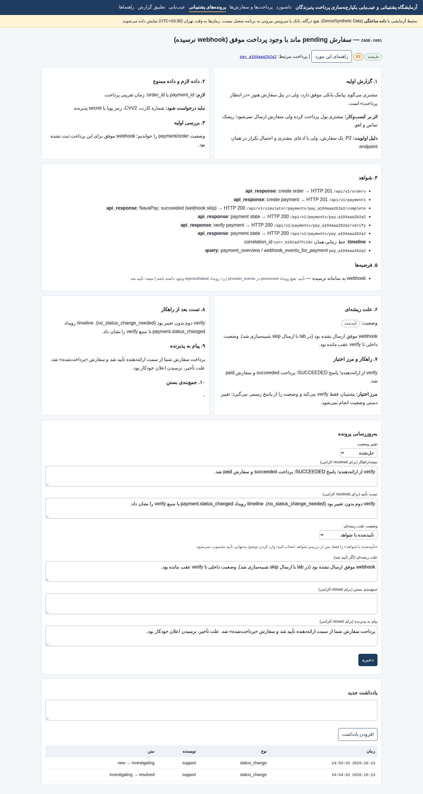
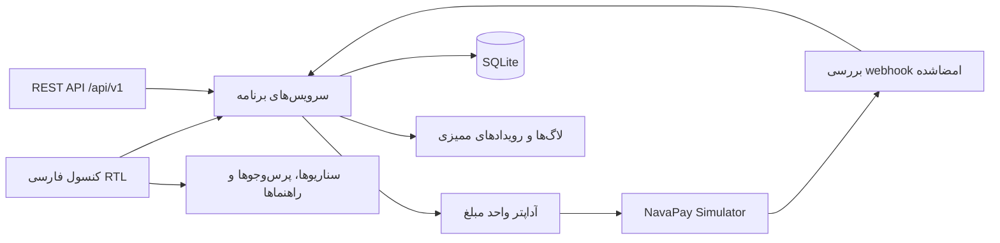

# آزمایشگاه پشتیبانی یکپارچه‌سازی پرداخت پذیرندگان

[English](README.md) · **فارسی**

> **فقط شبیه‌سازی.** این مخزن یک نمونه‌کار و محیط آموزشی محلی است. پرداخت واقعی انجام نمی‌دهد، به بانک، پرداخت‌یار یا درگاه واقعی وصل نمی‌شود و از دادهٔ واقعی مشتری یا تراکنش استفاده نمی‌کند. تمام پذیرنده‌ها، سفارش‌ها، پرداخت‌ها، پاسخ‌های ارائه‌دهنده و webhookها ساختگی هستند.

این پروژه یک آزمایشگاه عملی برای نمایش روش بررسی رخدادهای یکپارچه‌سازی پرداخت است: از پاسخ API، شواهد webhook و شناسهٔ هم‌بستگی تا لاگ‌های ساخت‌یافته، پرس‌وجوهای SQL فقط‌خواندنی، مغایرت‌های تطبیق و راهنماهای پروندهٔ پشتیبانی.

**مخاطبان هدف:** پشتیبانی فنی، Application Support، پشتیبانی نرم‌افزارهای مالی و پشتیبانی یکپارچه‌سازی پرداخت.

## تصاویر برنامه

| داشبورد | خط زمانی پرداخت |
|---|---|
|  |  |

| پروندهٔ پشتیبانی | مغایرت‌های تطبیق |
|---|---|
|  |  |

| پرس‌وجوی تشخیصی فقط‌خواندنی | تصویر مرورگر از پروندهٔ به‌روزشده |
|---|---|
|  |  |

پنج تصویر نخست، خروجی ثابت HTML تولیدشده توسط برنامه‌اند. تصویر ششم اسکرین‌شات تمام‌صفحهٔ Chromium از برنامهٔ در حال اجرا، پس از ساخت دوبارهٔ داده‌های آزمایشی است؛ این تصویر گزینهٔ صریح انتخاب وضعیت علت ریشه‌ای را در فرم پرونده نشان می‌دهد. جزئیات ثبت تصاویر در [screenshots/README.md](screenshots/README.md) آمده است.

## این آزمایشگاه چه چیزهایی را نشان می‌دهد؟

- **چرخهٔ پرداخت:** ساخت سفارش و پرداخت، بررسی وضعیت، استعلام از ارائه‌دهندهٔ شبیه‌سازی‌شده و بررسی ارتباط وضعیت سفارش و پرداخت.
- **رفتار ارائه‌دهنده و webhook:** شبیه‌سازی موفقیت، شکست، انقضا، timeout، نرسیدن webhook، تحویل تکراری یا امضای نامعتبر.
- **اعتبارسنجی webhook:** بررسی HMAC-SHA256 روی بدنهٔ خام درخواست، رد امضای نامعتبر پیش از پردازش، کنترل مبلغ و جلوگیری از پردازش چندبارهٔ یک event_id.
- **Idempotency:** برای Idempotency-Key و بدنهٔ یکسان، پاسخ ذخیره‌شده برگردانده می‌شود؛ استفاده از همان کلید با بدنهٔ متفاوت HTTP 409 می‌دهد.
- **مدیریت امن timeout:** پس از timeout وضعیت پرداخت unknown می‌شود، نه failed. باید وضعیت از ارائه‌دهنده استعلام شود؛ نباید پیش از روشن شدن وضعیت تلاش قبلی، پرداخت دیگری ساخته یا وضعیت دستی تغییر داده شود.
- **مبلغ و واحد پول:** مبلغ داخلی همیشه عدد صحیح ریال است. آداپتر واحد ارائه‌دهنده (IRR یا IRT) را صریح مدیریت می‌کند و در تبدیل غیرقابل‌دقیق خطا می‌دهد؛ گرد کردن مبلغ انجام نمی‌شود.
- **استرداد:** شبیه‌سازی استرداد جزئی و کامل با کنترل سقف ماندهٔ قابل استرداد.
- **خط زمانی شواهد:** ترکیب رویدادهای ممیزی، دریافت webhook، استردادها، لاگ‌ها و یادداشت‌های پرونده بر اساس payment_id یا correlation_id.
- **گردش کار پرونده:** ثبت گزارش پذیرنده، دادهٔ لازم و ممنوع، اولویت، بررسی‌ها، شواهد، فرضیه‌ها، علت ریشه‌ای، راهکار، مرز اختیار، اعتبارسنجی و پیام پذیرنده. علت ریشه‌ای باید صریحاً تعیین شود؛ وارد کردن متن به‌تنهایی آن را تأیید نمی‌کند. برای حل یا بستن پرونده فیلدهای الزامی وجود دارد.
- **تطبیق گزارش:** مقایسهٔ CSV ساختگی ارائه‌دهنده با رکوردهای داخلی و شناسایی پنج نوع مغایرت. مغایرت را می‌توان به پرونده وصل کرد یا با یادداشت حل کرد؛ هیچ ردیفی حذف یا مبلغی اصلاح نمی‌شود.
- **عیب‌یابی:** اجرای ۹ سناریوی ازپیش‌تعریف‌شده، بررسی لاگ‌های ساخت‌یافته و اجرای پرس‌وجوهای SQL ثابت و فقط‌خواندنی.
- **کنسول و راهنماهای فارسی:** کنسول وب فارسی و راست‌به‌چپ (RTL)، با HTML سمت سرور؛ بدون وابستگی به JavaScript یا CDN. مخزن ده راهنمای عیب‌یابی فارسی دارد.

## معماری

برنامه از WSGI و sqlite3 استاندارد پایتون، HTML سمت سرور و جزء داخلی شبیه‌سازی‌شده‌ای به نام NavaPay Simulator استفاده می‌کند. این پروژه یک آزمایشگاه محلی تک‌پردازه است؛ شبیه‌ساز به ارائه‌دهندهٔ واقعی وصل نیست.



جزئیات پیاده‌سازی: [معماری](docs/architecture.md) · [مدل دامنه](docs/domain-model.md) · [مرجع API و عیب‌یابی](docs/api-troubleshooting.md).

## راه‌اندازی سریع

**پیش‌نیاز:** Python نسخهٔ 3.12 یا بالاتر. برای اجرای اصلی برنامه نیازی به نصب بسته نیست؛ برنامه از کتابخانهٔ استاندارد پایتون استفاده می‌کند.

مخزن را دریافت کنید و وارد پوشهٔ آن شوید:

```bash
git clone https://github.com/Cyberi/Payment-Integration-Support-Workbench.git
cd Payment-Integration-Support-Workbench
```

ابتدا دیتابیس آزمایشی را از نو بسازید و سپس سرور را اجرا کنید. ترتیب فرمان‌ها را حفظ کنید.

**ویندوز (PowerShell)**

```powershell
py -3.12 -m scripts.reset_demo_data
py -3.12 -m app.main
```

**لینوکس / macOS**

```bash
python3.12 -m scripts.reset_demo_data
python3.12 -m app.main
```

مرورگر را در [http://127.0.0.1:8000](http://127.0.0.1:8000) باز کنید.

فرمان اول دیتابیس تعیین‌شده در LAB_DB_PATH را حذف و با پذیرنده‌ها، سناریوها، پرونده‌ها و مغایرت‌های ساختگی دوباره می‌سازد. اگر داده‌ای در دیتابیس دارید که باید حفظ شود، فرمان reset را اجرا نکنید. خروجی موفق چیزی شبیه این است:

```text
reset done. merchants=2 scenarios_ok=9/9 cases=8 reconciliation_exceptions=5
```

برنامه عمداً از اتصال به رابط شبکه‌ای غیر loopback خودداری می‌کند؛ برای استفادهٔ محلی روی یک دستگاه طراحی شده است، نه برای دسترسی شبکهٔ داخلی یا اینترنت عمومی.

## تنظیمات

مقادیر پیش‌فرض برای اجرای محلی مناسب‌اند. برای تغییرشان، .env.example را به .env کپی کنید؛ فایل .env در Git نادیده گرفته می‌شود.

```dotenv
LAB_HOST=127.0.0.1
LAB_PORT=8000
LAB_DB_PATH=var/lab.sqlite3
LAB_LOG_PATH=var/logs/app.jsonl
LAB_API_KEY=lab_demo_api_key_change_me
LAB_WEBHOOK_SECRET=lab_demo_webhook_secret_change_me
LAB_MAX_WEBHOOK_ATTEMPTS=3
```

این مقادیر **نمونه هستند و اعتبارنامهٔ تولیدی نیستند**. برنامه را فقط روی loopback اجرا کنید و secret واقعی را وارد مخزن نکنید. جزئیات در [امنیت و محدودیت‌ها](docs/security-and-limitations.md) آمده است.

## تست‌ها و CI

برای اجرای تست‌های واحد و یکپارچه‌سازی:

```bash
python -m unittest discover -s tests -t . -v
```

آخرین اجرای تأییدشدهٔ CI با Python 3.12 شامل **۲۱ تست موفق** بود. این تست‌ها جریان‌های پرداخت، timeout، webhook تکراری و نامعتبر، idempotency، سقف استرداد، مغایرت واحد مبلغ، تطبیق، شواهد مبتنی بر correlation ID، قوانین بستن پرونده، پالایش لاگ، اعتبارسنجی ورودی، تأیید صریح علت ریشه‌ای و محدودیت اتصال loopback را پوشش می‌دهند.

GitHub Actions همچنین بررسی می‌کند فایل Postman ذخیره‌شده با سازندهٔ آن هماهنگ باشد. هنگام push روی شاخه‌ای غیر از main، job جداگانه‌ای Chromium را اجرا می‌کند، برنامه را با دیتابیس تازه می‌سازد، از صفحهٔ پرونده اسکرین‌شات می‌گیرد و آن را به عنوان Artifact در اجرای workflow نگه می‌دارد.

[آخرین اجرای موفق CI](https://github.com/Cyberi/Payment-Integration-Support-Workbench/actions).

## Postman و نمونه‌های API

فایل postman/payment-integration-support.postman_collection.json را در Postman وارد کنید و مقادیر زیر را تنظیم کنید:

- **baseUrl:** پیش‌فرض http://127.0.0.1:8000 است، مگر آنکه پورت محلی را تغییر داده باشید.
- **apiKey:** کلید آزمایشی محلی که در .env یا .env.example قرار دارد.

پوشه‌های کالکشن را به‌ترتیب اجرا کنید. جریان happy path متغیرهای orderId، paymentId و کلید idempotency خود را ذخیره می‌کند. جریان timeout **سفارش و پرداخت جداگانه‌ای می‌سازد**، وضعیت آغازین unknown را بررسی می‌کند و سپس نتیجهٔ ارائه‌دهنده را استعلام می‌گیرد؛ بنابراین به سفارشی که در جریان قبلی پرداخت شده وابسته نیست.

کالکشن از postman/build_collection.py تولید می‌شود و CI هماهنگی JSON تولیدی با سازنده را بررسی می‌کند. ادعا نمی‌شود که این کالکشن در Postman یا Newman اجرا شده است. مثال‌های خط فرمان در [نمونه‌های curl](docs/curl-examples.md) هستند.

چند endpoint مهم:

| روش | مسیر | کاربرد |
|---|---|---|
| GET | /api/v1/health | بررسی اجرای سرویس محلی و حالت شبیه‌سازی |
| POST | /api/v1/orders | ساخت سفارش ساختگی |
| POST | /api/v1/payments | ساخت تلاش پرداخت؛ نیازمند Idempotency-Key |
| GET | /api/v1/payments/{payment_id} | بررسی وضعیت پرداخت، سفارش و استردادها |
| POST | /api/v1/payments/{payment_id}/verify | استعلام از شبیه‌ساز و تطبیق وضعیت داخلی با پاسخ |
| POST | /api/v1/simulator/payments/{payment_id}/complete | انتخاب نتیجهٔ شبیه‌سازی و حالت ارسال webhook |
| GET | /api/v1/timeline?payment_id=... | مشاهدهٔ خط زمانی شواهد |
| POST | /api/v1/diagnostics/scenarios/{name} | اجرای یک سناریوی عیب‌یابی |
| POST | /api/v1/reconciliation/runs/demo | تطبیق CSV ساختگی ذخیره‌شده در مخزن |

فهرست کامل مسیرها، هدرها و پاسخ‌های خطا در [مرجع API و عیب‌یابی](docs/api-troubleshooting.md) قرار دارد.

## نمونهٔ بررسی رخداد: CASE-1001

پروندهٔ نمونه دربارهٔ سفارشی است که هنوز در حالت انتظار مانده، در حالی که پذیرنده گزارش موفقیت پرداخت مشتری را می‌دهد. مسیر بررسی پشتیبان:

1. پرداخت را با payment_id یا order_id پیدا کند.
2. وضعیت پرداخت و سفارش را مقایسه و خط زمانی شواهد را بررسی کند.
3. تشخیص دهد webhook پردازش شده، رد شده یا اصلاً دریافت نشده است.
4. به‌جای اتکا به پیام مشتری یا تغییر مستقیم دیتابیس، نتیجه را از ارائه‌دهندهٔ شبیه‌سازی‌شده استعلام کند.
5. شواهد، فرضیه، وضعیت علت ریشه‌ای و راهکار را در پرونده ثبت کند.
6. پیش از حل یا بستن پرونده، وضعیت نهایی را اعتبارسنجی و پیام پذیرنده را ثبت کند.

هدف، نمایش روش درست بررسی است؛ نه فراهم‌کردن میان‌بری برای موفق اعلام کردن هر پرداخت. علت ریشه‌ای باید براساس شواهد و با انتخاب صریح ثبت شود و برای حل یا بستن پرونده، فیلدهای ضروری باید کامل باشند.

## ۹ سناریوی عیب‌یابی

| سناریو | چیزی که نشان می‌دهد |
|---|---|
| webhook-missing | موفقیت ارائه‌دهنده با webhook ازدست‌رفته و مسیر بازیابی از طریق verify |
| duplicate-webhook | تحویل تکراری یک رویداد بدون اعمال دوبارهٔ آن |
| timeout-unknown | نتیجهٔ نامشخص پس از timeout و استعلام بعدی |
| amount-unit-mismatch | تنظیم اشتباه واحد IRR/IRT که باید علامت‌گذاری شود، نه اینکه بی‌صدا پذیرفته شود |
| invalid-signature | رد webhook با امضای نامعتبر |
| idempotency-conflict | پاسخ تکراری برای درخواست یکسان و تعارض برای کلید مشترک با بدنهٔ متفاوت |
| order-payment-conflict | تعارض بین نتیجهٔ پرداخت و وضعیت سفارش |
| refund-limit | رد استرداد بیشتر از ماندهٔ قابل استرداد |
| reconciliation | شناسایی مغایرت بین رکورد داخلی و گزارش ساختگی ارائه‌دهنده |

برای مراحل بررسی، اقدامات مجاز، معیار ارجاع و اعتبارسنجی، [راهنماهای سناریو](docs/scenario-runbooks.md) و [راهنمای تطبیق](docs/reconciliation.md) را ببینید.

## مرزهای امنیتی و محدودیت‌ها

این مخزن نمونه‌کار و محیط آموزشی است، **نه سامانهٔ پرداخت آمادهٔ تولید**.

- تمام پذیرنده‌ها، تراکنش‌ها، رویدادهای ارائه‌دهنده و گزارش‌های تطبیق ساختگی هستند.
- شماره کارت، CVV2، رمز کارت، اعتبارنامهٔ بانکی یا هویت واقعی مشتری لازم نیست.
- امضای webhook با HMAC-SHA256 بررسی می‌شود؛ امضای نامعتبر پیش از پردازش رویداد رد می‌شود.
- پرس‌وجوهای تشخیصی از میان queryهای نام‌گذاری‌شده و ثابت انتخاب می‌شوند و پارامترها bind می‌شوند؛ UI SQL آزاد قبول نمی‌کند.
- بدنهٔ درخواست در لاگ ذخیره نمی‌شود؛ secretها و رشته‌های شبیه شماره کارت پالایش یا ماسک می‌شوند.
- مبالغ عدد صحیح و واحدها صریح‌اند؛ مجموع استرداد از ماندهٔ قابل استرداد بیشتر نمی‌شود.
- برنامه تک‌پردازه و متکی به SQLite است و در هر لحظه یک نویسنده دارد. ارائه‌دهنده فقط شبیه‌ساز داخلی است و به بانک، PSP یا درگاه واقعی وصل نیست.
- کلید API و secret نمونه ثابت‌اند. ورود کاربر، نقش‌ها، MFA، TLS، محدودیت نرخ، چرخش کلید، سیاست پشتیبان‌گیری، نگهداری داده و رمزنگاری در حالت سکون پیاده‌سازی نشده‌اند.
- ارسال مجدد webhook دستی و دارای سقف است. استردادها در شبیه‌ساز فوری‌اند، برخلاف سامانه‌های واقعی که ممکن است ناهم‌زمان باشند.

این سرویس را در معرض شبکه قرار ندهید و برای تراکنش واقعی استفاده نکنید. در [امنیت و محدودیت‌ها](docs/security-and-limitations.md) توضیح کامل‌تر و کنترل‌های موردنیاز برای محصول واقعی آمده است.

## ساختار مخزن

```text
app/
  domain/       قوانین مبلغ و ماشین حالت موجودیت‌ها
  services/     سفارش، پرداخت، استرداد، شبیه‌ساز، پرونده و تطبیق
  support/      پرس‌وجوهای ثابت، سناریوها و راهنماهای فارسی
  web/          REST API، کنسول HTML و عملیات فرم‌ها
data/examples/  CSV ساختگی تراکنش‌های ارائه‌دهنده
docs/           معماری، API، مدل دامنه، راهنماها و امنیت
postman/        کالکشن و سازندهٔ آن
scripts/        reset/seed، خروجی راهنماها و ثبت/رندر تصویر
screenshots/    تصاویر کنسول و مستندات ثبت آن‌ها
tests/          تست‌های unittest (سازگار با pytest)
```

## مجوز

MIT. فایل [LICENSE](LICENSE) را ببینید.

## Developed by

Vahid Razavi
