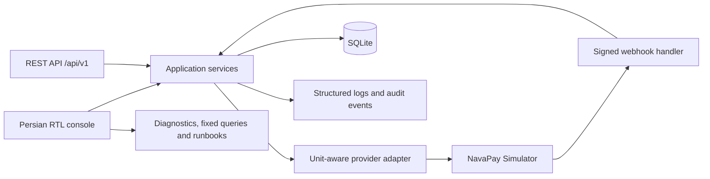

# Payment Integration Support Workbench

**English** · [فارسی — نسخهٔ فارسی](README.fa.md)

> **Simulation only.** This repository is a local training and portfolio project. It does not process real payments, connect to a bank, payment service provider (PSP) or gateway, or use real customer or transaction data. All merchants, orders, payments, provider responses and webhooks are synthetic.

A hands-on lab for demonstrating how an application-support analyst investigates payment-integration incidents using API responses, webhook evidence, correlation IDs, structured logs, named read-only SQL queries, reconciliation exceptions and support-case runbooks.

**Intended audience:** technical support, application support, financial-software support and payment-integration support roles.

## Screenshots

| Dashboard | Payment timeline |
|---|---|
|  |  |

| Support case | Reconciliation exceptions |
|---|---|
|  |  |

| Read-only diagnostic query | Browser capture of the updated support case |
|---|---|
|  |  |

The first five images are static renders of the application's server-rendered HTML. The sixth is a full-page Chromium screenshot captured from the running application after the demo database was seeded; it shows the explicit root-cause status selector in the support-case form. See [screenshots/README.md](screenshots/README.md) for capture details.

## What the lab demonstrates

- **Payment lifecycle:** create an order and payment, query status, verify with the simulated provider, and inspect how order and payment states relate.
- **Provider and webhook behaviour:** simulate success, failure, expiry, timeout, a missing webhook, a duplicate delivery or an invalid signature.
- **Webhook verification:** validate HMAC-SHA256 against the raw request body, reject invalid signatures before processing, check the amount and prevent duplicate event processing by event_id.
- **Idempotency:** replay the stored response for the same Idempotency-Key and same request body; return HTTP 409 when the same key is reused with a different body.
- **Timeout safety:** a timeout results in unknown, not an assumed failure. The next step is to verify the outcome rather than creating a second payment or manually changing the state.
- **Money and unit handling:** monetary amounts are integers in IRR internally. The adapter explicitly handles the configured provider unit (IRR or IRT) and refuses inexact conversion; it does not round amounts.
- **Refunds:** simulate partial and full refunds while enforcing the remaining refundable balance.
- **Evidence timeline:** follow audit events, webhook receipts, refunds, logs and case notes by payment_id or correlation_id.
- **Support-case workflow:** record the merchant report, required and prohibited data, priority, checks, evidence, hypotheses, root cause, resolution, authority boundary, validation and merchant message. A root cause must be explicitly marked; entering text alone does not confirm it. Resolution and closure have required fields.
- **Reconciliation:** compare a synthetic provider CSV with internal records and flag five exception types. Exceptions can be linked to a support case or resolved with a note; reconciliation does not delete rows or alter transaction amounts.
- **Diagnostics:** run nine predefined scenarios, inspect structured logs and execute named read-only SQL queries.
- **Persian console and runbooks:** the web console is Persian and right-to-left (RTL), server-rendered, and does not rely on JavaScript or a CDN. The repository includes ten Persian runbooks.

## Architecture

The application uses Python's standard-library WSGI server, sqlite3, server-rendered HTML and a separate in-process component named NavaPay Simulator. It is a single-process local lab; the provider simulator is not a real external integration.



Implementation details: [Architecture](docs/architecture.md) · [Domain model](docs/domain-model.md) · [API reference and troubleshooting](docs/api-troubleshooting.md).

## Quick start

**Requirements:** Python 3.12 or newer. No runtime package installation is required; the workbench uses the Python standard library.

Clone the repository and open its directory:

```bash
git clone https://github.com/Cyberi/Payment-Integration-Support-Workbench.git
cd Payment-Integration-Support-Workbench
```

Reset and seed the synthetic database, then start the server. Run these commands in order.

**Windows (PowerShell)**

```powershell
py -3.12 -m scripts.reset_demo_data
py -3.12 -m app.main
```

**Linux / macOS**

```bash
python3.12 -m scripts.reset_demo_data
python3.12 -m app.main
```

Open [http://127.0.0.1:8000](http://127.0.0.1:8000).

The first command deletes the database at the configured LAB_DB_PATH and rebuilds it with synthetic merchants, scenarios, support cases and reconciliation exceptions. Do not run the reset command against a database whose contents you need to preserve. A successful reset prints a summary similar to:

```text
reset done. merchants=2 scenarios_ok=9/9 cases=8 reconciliation_exceptions=5
```

The app intentionally refuses to bind to a non-loopback network interface. It is designed for local use on one machine, not for exposure to a LAN or the public internet.

## Configuration

The defaults are suitable for a local demo. To override them, copy .env.example to .env; .env is ignored by Git.

```dotenv
LAB_HOST=127.0.0.1
LAB_PORT=8000
LAB_DB_PATH=var/lab.sqlite3
LAB_LOG_PATH=var/logs/app.jsonl
LAB_API_KEY=lab_demo_api_key_change_me
LAB_WEBHOOK_SECRET=lab_demo_webhook_secret_change_me
LAB_MAX_WEBHOOK_ATTEMPTS=3
```

These are **demo values, not production credentials**. Keep the application on loopback and do not place real secrets in the repository. Relevant configuration, controls and limitations are documented in [Security and limitations](docs/security-and-limitations.md).

## Tests and continuous integration

Run the unit and integration suite with:

```bash
python -m unittest discover -s tests -t . -v
```

The latest verified CI run on Python 3.12 passed **21 tests**. The suite covers payment flows, timeout handling, duplicate and invalid webhooks, idempotency, refund limits, unit mismatch handling, reconciliation, correlation-based evidence, case closure rules, log redaction, input validation, explicit root-cause confirmation and loopback-only binding.

GitHub Actions also checks that the checked-in Postman collection matches the collection generator. On pushes to a non-main branch, a separate job launches Chromium, starts a freshly seeded local instance, captures the support-case page and uploads the image as a workflow artifact.

[Latest successful CI run](https://github.com/Cyberi/Payment-Integration-Support-Workbench/actions).

## Postman and API examples

Import postman/payment-integration-support.postman_collection.json into Postman. Set:

- **baseUrl** to http://127.0.0.1:8000 unless you changed the local port.
- **apiKey** to the local demo key configured in .env or .env.example.

Run the collection folders in order. The happy-path flow stores its own orderId, paymentId and idempotency key. The timeout flow creates a **separate order and payment**, asserts that the initial status is unknown, then verifies the provider's result. This avoids depending on an order that was already paid by the happy-path flow.

The collection is generated by postman/build_collection.py; CI verifies that the generated JSON is in sync with that builder. The collection has **not** been represented as having been executed in Postman or Newman. For command-line request examples, see [curl examples](docs/curl-examples.md).

Important endpoints include:

| Method | Endpoint | Purpose |
|---|---|---|
| GET | /api/v1/health | Check that the local service is running and reports simulation mode |
| POST | /api/v1/orders | Create a synthetic order |
| POST | /api/v1/payments | Create a payment attempt; requires Idempotency-Key |
| GET | /api/v1/payments/{payment_id} | Inspect payment, order and refund state |
| POST | /api/v1/payments/{payment_id}/verify | Query the simulated provider and reconcile the local state with its answer |
| POST | /api/v1/simulator/payments/{payment_id}/complete | Choose a simulated outcome and webhook delivery mode |
| GET | /api/v1/timeline?payment_id=... | Review the evidence timeline |
| POST | /api/v1/diagnostics/scenarios/{name} | Execute one of the diagnostic scenarios |
| POST | /api/v1/reconciliation/runs/demo | Run reconciliation against the committed synthetic CSV |

The full list of routes, headers and error responses is in [docs/api-troubleshooting.md](docs/api-troubleshooting.md).

## Incident walkthrough: CASE-1001

The seeded case describes an order that remains pending even though the merchant reports a successful customer payment. A support analyst should:

1. Locate the payment using payment_id or order_id.
2. Compare the payment and order states, then inspect the evidence timeline.
3. Check whether a webhook was processed, rejected or never received.
4. Verify the outcome with the simulated provider instead of trusting a customer message or manually changing the database.
5. Record the evidence, the hypothesis, the root-cause status and the resolution in the support case.
6. Validate the final state and write the message to the merchant before resolving or closing the case.

The lab demonstrates the workflow; it does not prescribe a shortcut to mark any payment as successful. Root cause is an explicit evidence-based choice, and the application enforces required information before case resolution or closure.

## The nine diagnostic scenarios

| Scenario | What it demonstrates |
|---|---|
| webhook-missing | Provider success with a missing webhook, followed by a safe verification path |
| duplicate-webhook | Duplicate event delivery without applying the same event twice |
| timeout-unknown | Uncertain outcome after a provider timeout and subsequent verification |
| amount-unit-mismatch | A misconfigured IRR/IRT unit that must be flagged rather than silently accepted |
| invalid-signature | Rejecting an invalid webhook signature |
| idempotency-conflict | Replay for the same request and conflict for a reused key with a different body |
| order-payment-conflict | A payment outcome that conflicts with the order state |
| refund-limit | Rejecting a refund greater than the remaining refundable amount |
| reconciliation | Detecting differences between the internal ledger and a synthetic provider report |

See [Scenario runbooks](docs/scenario-runbooks.md) and [Reconciliation](docs/reconciliation.md) for the checks, permitted actions, escalation criteria and verification steps.

## Security boundaries and known limitations

This repository is a portfolio/training lab, **not a production payment system**.

- All merchants, transactions, provider events and reconciliation reports are synthetic.
- No card numbers, CVV2, PINs, bank credentials or real customer identities are required.
- Webhook signatures are checked with HMAC-SHA256; invalid signatures are rejected before event processing.
- Diagnostic SQL is selected from named fixed queries with bound parameters; the UI does not accept arbitrary SQL.
- Request bodies are not logged; sensitive values and PAN-like digit sequences are redacted or masked.
- Money uses integer amounts and explicit units; refunds cannot exceed the remaining refundable balance.
- The service is a single process with SQLite and one writer at a time. The provider is an in-process simulator; it does not connect to any real bank, PSP or gateway.
- The demo API key and webhook secret are static examples. There is no user login, role-based access, MFA, TLS, rate limiting, key rotation, backup policy, retention policy or encryption-at-rest policy.
- Webhook redelivery is manual and capped. Refunds complete instantly in the simulator, unlike real asynchronous payment systems.

Do not expose this service to a network or use it to process real transactions. See [Security and limitations](docs/security-and-limitations.md) for a fuller breakdown and the controls a production system would need.

## Repository map

```text
app/
  domain/       Money rules and entity state machines
  services/     Orders, payments, refunds, simulator, cases and reconciliation
  support/      Fixed diagnostic queries, scenarios and Persian runbooks
  web/          REST API, HTML console and form actions
data/examples/  Synthetic provider CSV
docs/           Architecture, API, domain model, runbooks and security notes
postman/        Collection and its generator
scripts/        Reset/seed, runbook export and screenshot capture/rendering
screenshots/    Console screenshots and capture notes
tests/          unittest suite (also pytest-compatible)
```

## License

MIT. See [LICENSE](LICENSE).

## Developed by

Vahid Razavi
