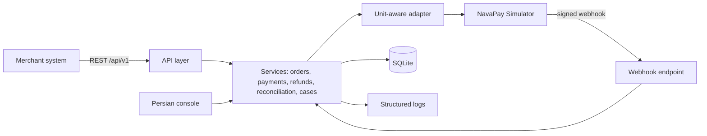
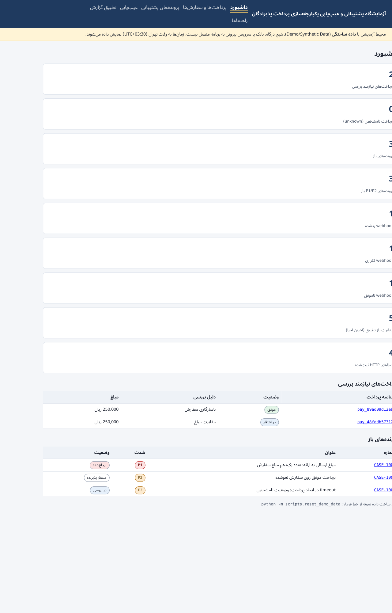
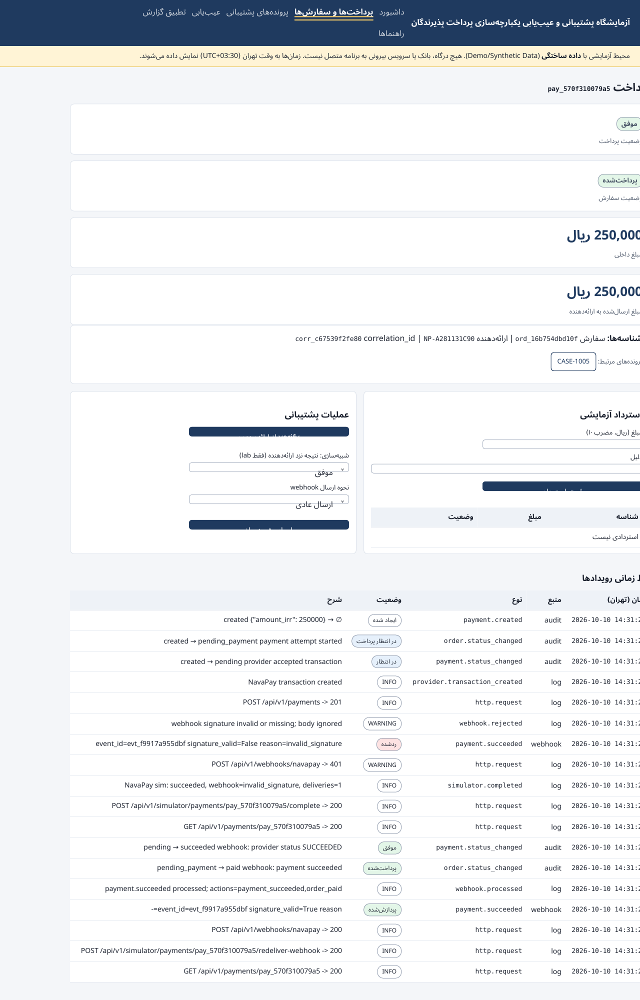
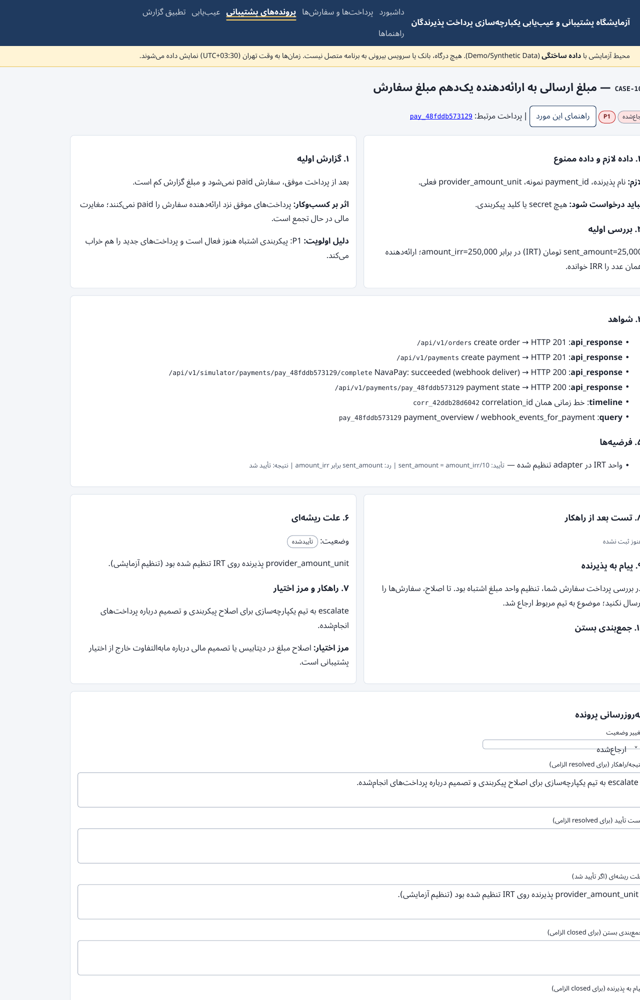
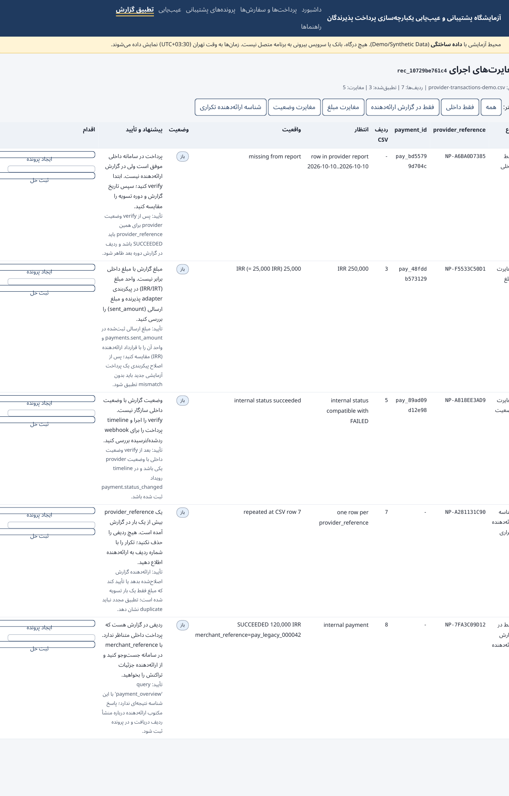
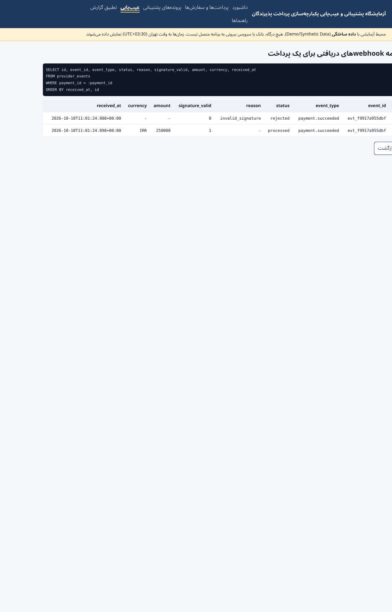

# Payment Integration Support Workbench

> **Simulation only.** This is a local support lab. It has no real payment processing, no real provider connection and no real customer data. Every merchant, order, payment and webhook is synthetic.

A local fintech support lab for diagnosing mocked payment API, webhook, verification, refund and reconciliation issues with traceable evidence, SQL queries, and repeatable runbooks.

**Demo banner:** the console shows "Demo/Synthetic Data" on every page.

## Who this is for
Technical support, application support and payment-integration support people at non-bank companies (fintech, payment-service providers, financial SaaS) who want to show how they investigate an incident: from a merchant's report, through API calls, webhooks, logs and database evidence, to a root cause, a fix, a validation and a message back to the merchant.

## The problem being modelled
A shop called **Sefid Market** (fictional) uses a fictional provider, **NavaPay Simulator**. Payments fail in ways that look alike from the outside: a webhook never arrives, a timeout hides the real outcome, a retry duplicates an event, a unit setting is wrong, a signature is stale, a cancelled order gets paid. The lab reproduces these cases and shows how to tell them apart with evidence.

## What is implemented
- **Payments and orders:** create order, start a payment attempt, read status, verify with the provider, cancel with a warning when a payment is still open.
- **Provider simulator:** decides success, failure or expiry; sends signed webhooks; can skip, duplicate or sign wrongly; can time out on request.
- **Webhooks:** HMAC-SHA256 signature check, duplicate protection by `event_id`, unknown-transaction handling, amount checks, every delivery stored.
- **Idempotency:** `Idempotency-Key` replay for the same body; HTTP 409 for the same key with a different body.
- **Refunds (test):** partial and full, with a hard limit on the refundable remainder.
- **Unit-aware adapter:** integer IRR internally, explicit IRT/IRR setting per merchant, exact conversion or error.
- **Evidence:** payment timeline (audit, webhooks, refunds, logs, case notes) by `payment_id` or `correlation_id`; structured logs with redaction; named read-only SQL queries.
- **Support cases:** 11-step structure (report, data needed, priority, checks, evidence, hypotheses, root cause, resolution, authority boundary, validation, merchant message). Status rules block `resolved` and `closed` until the required fields are filled.
- **Reconciliation:** synthetic provider CSV, five exception types (`internal_only`, `provider_only`, `amount_mismatch`, `status_mismatch`, `duplicate_provider_reference`), each linked to a case or resolved with a note. No row is ever deleted and no amount is ever changed.
- **Runbooks (Persian):** ten runbooks, each with symptom, preconditions, data needed, checks, queries, APIs, allowed and forbidden actions, escalation, verification and a sample merchant message.
- **Console (Persian, RTL):** dashboard, payments and timeline, support cases, diagnostics, reconciliation, runbooks.
- **Postman collection** and **curl examples** for every main flow.

### Planned, not built
Nothing is advertised beyond what runs. Possible next steps are listed under *Known limitations*.

## Architecture

Details and decisions: [docs/architecture.md](docs/architecture.md).

## Screenshots
| | |
|---|---|
|  | **Dashboard.** Live counters from the seeded database: payments to review, open cases, webhook rejections and duplicates. |
|  | **Payment timeline.** Audit events, webhook receipts (with signature validity), logs and case notes in one order. |
|  | **Support case.** The 11-step structure with evidence and a root-cause status that can stay "unknown". |
|  | **Reconciliation exceptions.** Each mismatch has a suggestion, a verification step and a case link. |
|  | **Diagnostic query.** A named, read-only SQL query and its rows for one payment. |

Captions and how the images were made: [screenshots/README.md](screenshots/README.md).

## Quick start

**Requirements:** Python 3.12 or newer. No packages to install. The app uses only the standard library.

### Windows (PowerShell)
```powershell
py -3.12 -m scripts.reset_demo_data
py -3.12 -m app.main
```
Open http://127.0.0.1:8000

### Linux / macOS
```bash
python3.12 -m scripts.reset_demo_data
python3.12 -m app.main
```
Open http://127.0.0.1:8000

Optional: copy `.env.example` to `.env` to change the port or demo keys. `.env` is git-ignored. This simulation-only app refuses to bind to non-loopback network interfaces; keep it on `127.0.0.1` or `localhost`.

## Database seed and reset
- `python -m scripts.reset_demo_data` deletes `var/lab.sqlite3`, creates the schema, runs the scenarios, writes the demo CSV, and opens eight support cases. It takes a few seconds and is repeatable: IDs are deterministic.
- `python -m scripts.seed_demo_data` does the same without the summary line.
- The demo CSV is `data/examples/provider-transactions-demo.csv`.

Expected output of reset:
```
reset done. merchants=2 scenarios_ok=9/9 cases=8 reconciliation_exceptions=5
```

## Running the tests
```bash
python -m unittest discover -s tests -t . -v
```
(`pytest` also collects these tests if you have it installed; this environment did not have pytest, so the run below used unittest.)

Actual output from the last run in this repository:
```
Ran 18 tests in 0.345s

OK
```
The tests cover: happy path; timeout stays `unknown` until verify; duplicate webhook has no second effect; invalid signature rejected; unsigned webhook rejected without processing its body; idempotency replay and conflict; refund over the limit; unit misconfiguration flagged; reconciliation exception types; timeline by correlation ID; case closure rules; no secrets or signatures in logs; invalid input returns 422 with field details; state machine and money rules.

## Postman
Import `postman/payment-integration-support.postman_collection.json`. Set `baseUrl` (default `http://127.0.0.1:8000`) and `apiKey` (demo value in `.env.example`). Run folders in order. The happy-path folder stores `orderId`, `paymentId`, and the idempotency key for the replay checks; the timeout folder creates its own order and stores a separate `timeoutPaymentId` so it does not depend on the already-paid happy-path order. The collection file is generated by `postman/build_collection.py`. I validated the JSON structure but did not run it in Postman or newman in this environment.

## Scenario walkthrough: from merchant report to resolution
The seeded case **CASE-1001** ("order stayed pending even though the provider says paid"):
1. **Report:** the merchant says the customer's bank SMS shows success, but the order is still pending.
2. **Data needed:** `payment_id` or `order_id`. Not needed: card number, CVV2, secrets.
3. **Priority:** P2. One order, but the customer has paid.
4. **Checks:** `GET /api/v1/payments/{id}` shows `pending` and `pending_payment`. `webhook_events_for_payment` shows no processed event.
5. **Evidence:** the timeline for the same correlation ID.
6. **Hypothesis:** the webhook never arrived. Confirm if there is no processed event; reject if there is a rejected one.
7. **Action:** `POST /api/v1/payments/{id}/verify`. The provider answers SUCCEEDED, so the payment becomes `succeeded` and the order `paid`.
8. **Validation:** a second verify changes nothing (`no_status_change_needed`).
9. **Message to merchant:** the order was confirmed by the provider; the cause was a missed notification.
10. **Closure:** status `resolved` with resolution and validation filled in. Root cause is `confirmed` because the lab simulated it.

Open it in the console at `/cases/CASE-1001`, or see the other seven cases (`CASE-1002` to `CASE-1008`).

## The nine scenarios
Run them from the Diagnostics page or `POST /api/v1/diagnostics/scenarios/{name}`:
`webhook-missing`, `duplicate-webhook`, `timeout-unknown`, `amount-unit-mismatch`, `invalid-signature`, `idempotency-conflict`, `order-payment-conflict`, `refund-limit`, `reconciliation`. Each one drives the real API and reports its steps and correlation ID.

## Data, privacy and security boundaries
- All data is synthetic. Merchant names are fictional. The provider is fictional.
- No card numbers, CVV2, PINs, bank credentials or customer identity are collected or stored.
- No secrets are in the repository. The demo API key and webhook secret in `.env.example` are placeholders for a local lab only.
- Logs never contain request bodies or secrets. Tests check this.
- Details and the list of controls that are training-only: [docs/security-and-limitations.md](docs/security-and-limitations.md).

## Documentation
- [Architecture](docs/architecture.md) · [Domain model](docs/domain-model.md) · [API and troubleshooting](docs/api-troubleshooting.md)
- [Scenario runbooks and incident samples](docs/scenario-runbooks.md) · [Reconciliation](docs/reconciliation.md)
- [Security and limitations](docs/security-and-limitations.md) · [curl examples](docs/curl-examples.md)
- Persian summary: [README.fa.md](README.fa.md)

## Known limitations and realistic next steps
- Single process, SQLite, one writer at a time.
- The simulator models one plausible provider behaviour. It is not a description of any real provider.
- Webhook retries are manual, capped by `LAB_MAX_WEBHOOK_ATTEMPTS`. A real system needs a durable retry queue.
- Next steps, in order of value: a background retry worker; a richer merchant-side test harness; a second, deliberately different provider adapter to show the boundary; a review of the Persian text by a native-speaking support lead.

## Repository layout
```
app/                 application code (domain, services, support, web, console)
scripts/             reset/seed, runbook export, screenshot render
postman/             collection and its generator
docs/                architecture, API, runbooks, reconciliation, security
data/examples/       synthetic provider CSV
tests/               unittest tests (pytest-compatible)
screenshots/         real renders of the console with captions
```

## License
MIT. See [LICENSE](LICENSE).
