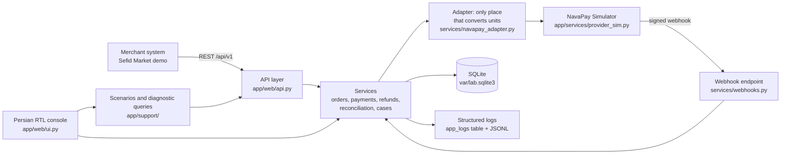

# Architecture

## Scope
A local support workbench that lets a support analyst follow one payment from a merchant report to a verified resolution. Everything is synthetic. The "provider" is `NavaPay Simulator`, a fake component inside this process. Nothing talks to a bank, a PSP or the internet.

## Components

## Decisions
- **Standard library only (WSGI, sqlite3, http).** The lab must run from a clean Python 3.12 install without downloads. FastAPI, SQLAlchemy and Jinja2 are reasonable choices, but the repository was built in an environment without package installation, and the reviewer should be able to run it with zero setup. Routing, validation, correlation IDs and logging are about 400 lines and are fully visible.
- **Plain SQL.** Support analysts need to read the queries. `app/support/queries.py` holds the named diagnostic queries that the console and the sqlite3 CLI can both run.
- **SQLite file.** No server to install. `scripts/reset_demo_data.py` deletes and rebuilds it.
- **Server-rendered HTML, no JavaScript, no CDN.** Forms POST and redirect. Works offline.
- **Simulator is a separate contract.** The merchant reads provider state only through the simulator's interface (inquiry, webhook, report). Its tables are in the same file for convenience, but the code path is the same one a real integration would use.

## State machines
Defined once in `app/domain/states.py`. Any transition not listed raises `InvalidTransition`, which returns HTTP 409.

| Entity | States | Key rule |
|---|---|---|
| Order | created, pending_payment, paid, cancelled, partially_refunded, refunded | cancelled never becomes paid. |
| Payment | created, pending, succeeded, failed, unknown, expired, partially_refunded, refunded | A timeout sets `unknown`. Only provider evidence moves it. |
| Webhook event | received, processed, duplicate, rejected, failed | `processed` is unique per `event_id` (partial unique index). |
| Refund | requested, pending, succeeded, failed | Sum of refunds never exceeds the paid amount. |
| Support case | new, investigating, waiting_for_merchant, escalated, resolved, closed | `resolved` needs resolution, validation and a root-cause status. `closed` needs a closure summary and a merchant message. |

## Request flow (happy path)
1. `POST /api/v1/orders` creates an order in `created`.
2. `POST /api/v1/payments` (with `Idempotency-Key`) creates a payment, sends a transaction to the simulator through the adapter (IRR to provider unit), and moves the payment to `pending`.
3. `POST /api/v1/simulator/payments/{id}/complete` decides the outcome on the provider side and posts a signed webhook to `/api/v1/webhooks/navapay` in-process.
4. The webhook handler checks the signature, then the event ID, then the transaction, then the amount. Only then does it change state.
5. `GET /api/v1/timeline?payment_id=` merges audit events, webhook receipts, refunds, logs and case notes.

## Correlation IDs
- Every request gets `X-Correlation-ID` from the client if valid, otherwise a new one. It is returned in the response header and in every error body.
- Payment-scoped calls inherit the payment's original correlation ID, so a later verify or webhook still joins the same timeline.
- In-process simulator webhooks carry the payment's correlation ID as a header.

## Logging
Each request writes one structured line (timestamp, level, event_type, correlation_id, order_id, payment_id, provider_reference, endpoint, status_code, duration_ms, short_message) to the `app_logs` table and to `var/logs/app.jsonl`. Bodies are never logged. Known secrets are replaced by `[REDACTED]`, and PAN-like numbers and `Bearer` tokens are masked before writing.

## What was deliberately left out
React, microservices, Redis, Docker, Kibana, a real auth system, role-based access, a real gateway, SMS and cloud deployment. Each would add surface area without helping the support story.
